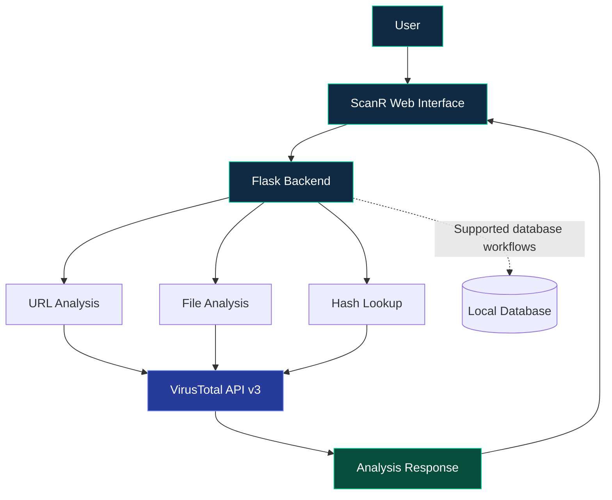

<div align="center">


<br/>


<br/><br/>

**A web-based platform for URL, file and hash analysis using VirusTotal intelligence.**

[Explore Repository](https://github.com/GhostMaskR/ScanR) · [Installation](#-installation) · [API Reference](#-api-reference) · [Security](#-security)

</div>

---

<div align="center">


</div>

## `01` — Overview

**ScanR** is a cybersecurity development project built with Python and Flask. It brings supported URL, file and hash analysis workflows together with VirusTotal threat-intelligence lookups.

The aim is to make security investigation easier through a web interface, backend scanning modules and supporting database components.

> **Development notice:** ScanR is still under development. Each module must be configured and tested independently. Features listed here describe repository components and are not a guarantee of production readiness.

## `02` — What ScanR Helps You Do

ScanR groups common first-pass threat-intelligence checks into one local web application:

- **URL analysis:** submit a URL to retrieve the analysis supported by the current URL-scanning implementation and VirusTotal.
- **File analysis:** submit a file through the file-analysis endpoint and inspect the available report.
- **Hash lookup:** query a file hash without uploading the original file, when a matching VirusTotal record is available.
- **Relationship lookups:** query supported file relationships, such as related domains, where the API and account permissions allow it.
- **Scan history:** access saved scan-history records through the history endpoints, where supported by the configured database.
- **Local status checks:** inspect application and module status through the health/status endpoints.

**Important distinction:** VirusTotal is an intelligence source, not a guarantee that a submitted item is safe or malicious. Results depend on the item, the available vendors, the time of analysis, the API plan and the response returned by VirusTotal.

## `03` — Feature Matrix

<table>
<tr>
<td width="50%" valign="top">

### 

Submit URLs through the supported analysis workflow to investigate available threat-intelligence results.

</td>
<td width="50%" valign="top">

### 

Use the file-analysis components to inspect supported files through the backend.

</td>
</tr>
<tr>
<td width="50%" valign="top">

### 

Query supported file hashes against available VirusTotal intelligence.

</td>
<td width="50%" valign="top">

### 

Use VirusTotal API v3 for supported analysis and relationship lookups.

</td>
</tr>
<tr>
<td width="50%" valign="top">

### 

Access the supported scanning workflows through the Flask-served web interface.

</td>
<td width="50%" valign="top">

### 

The repository includes database components for local application data and scan-history workflows.

</td>
</tr>
</table>

### Protection components

The repository also includes protection and feed-related modules. Browser protection, automatic monitoring and other protection features should be treated as **separate components requiring verification** before use.

## `04` — Technology Stack

<div align="center">


<br/><br/>


</div>

## `05` — System Architecture



<details>
<summary><strong>How the workflow operates</strong></summary>

1. The user interacts with the web interface.
2. Flask routes the request to the appropriate analysis component.
3. The relevant scanner communicates with VirusTotal when required.
4. The backend processes the response and returns available results.
5. Supported database routes handle local application data.

Exact request formats, error handling and API permissions depend on the implementation.

</details>

## `06` — Repository Structure

```text
ScanR/
├── app.py
├── requirements.txt
├── .env.example
├── database/
├── scanner/
│   ├── file_scanner.py
│   ├── hash_scanner.py
│   ├── hash_utils.py
│   ├── relations_api.py
│   ├── url_scanner.py
│   └── virustotal.py
├── scanr_protection/
├── static/
│   └── index.html
├── files/
├── tests/
├── reports/
├── LICENSE
└── README.md
```

This is a simplified overview. Additional scripts and modules may exist in the repository.

## `07` — Installation

### Requirements

- Python 3.10 or newer recommended
- Git
- Internet connection for VirusTotal lookups
- Your own VirusTotal API key

### Step 1 — Clone

```bash
git clone https://github.com/GhostMaskR/ScanR.git
cd ScanR
```

### Step 2 — Create a virtual environment

**Windows PowerShell**

```powershell
py -m venv .venv
.\.venv\Scripts\Activate.ps1
```

If activation is blocked, allow it only for the current PowerShell process:

```powershell
Set-ExecutionPolicy -Scope Process -ExecutionPolicy Bypass
.\.venv\Scripts\Activate.ps1
```

**Linux / macOS**

```bash
python3 -m venv .venv
source .venv/bin/activate
```

### Step 3 — Install dependencies

```bash
python -m pip install --upgrade pip
pip install -r requirements.txt
```

### Step 4 — Configure your API key

Create a local `.env` file in the project root:

```dotenv
VT_API_KEY=your_own_virustotal_api_key
```

Replace the placeholder with your own VirusTotal API key.

**Never publish your real `.env` file or API key.** Keep `.env.example` limited to placeholder values.

### Step 5 — Run ScanR

```powershell
python app.py
```

Open the local URL shown in the terminal. If Flask uses its default local development address, it is commonly:

`http://127.0.0.1:5000`

If startup fails, check dependencies, environment variables, terminal errors and API permissions.

## `08` — API Reference

The following routes are present in the current ScanR application structure. Request bodies and response fields can evolve with the implementation, so use the route handlers as the final authority before writing integrations.

| Endpoint | Purpose |
|---|---|
| `GET /` | Web interface |
| `GET /health` | Health check |
| `GET /api/status` | Application/scanner status |
| `GET /api/history` | Scan history |
| `GET /api/history/<scan_id>` | Individual history entry |
| `POST /api/scan/url` | URL-analysis workflow |
| `POST /api/scan/file` | File-analysis workflow |
| `POST /api/scan/hash` | Hash-analysis workflow |
| `GET /api/file/<resource_id>/<relation>` | File relationship lookup |
| `POST /api/relations` | Relationship query |
| `GET /api/relations/status` | Relationship module status |

### Example local API calls

These examples show the general shape of a local request. Confirm the exact JSON fields accepted by the current route handler before relying on them in automation.

**Check application status**

```powershell
Invoke-RestMethod -Uri "http://127.0.0.1:5000/api/status" -Method Get
```

**Check the health endpoint**

```powershell
Invoke-RestMethod -Uri "http://127.0.0.1:5000/health" -Method Get
```

**Read scan history**

```powershell
Invoke-RestMethod -Uri "http://127.0.0.1:5000/api/history" -Method Get
```

For URL, file, hash and relationship scans, check the corresponding route in `app.py` or `scanner/relations_api.py` for the required form fields, JSON keys and error responses. Avoid guessing a payload schema from the endpoint name alone.

Some relationship queries may be restricted by the VirusTotal account or API plan, and an upstream `403` response may indicate insufficient permissions rather than a local application defect.

## `09` — Screenshots & Demo

<div align="center">

| Dashboard | Analysis Results |
|---|---|
| Add `docs/screenshots/dashboard.png` | Add `docs/screenshots/results.png` |

</div>

> These are screenshot placeholders, not existing images. Replace them with genuine screenshots from a running ScanR instance.

## `10` — Testing & Verification

Run the test suite from the repository root if the project has the test dependencies installed:

```powershell
python -m pytest
```

If `pytest` is not installed, install it in the active virtual environment with `python -m pip install pytest`, then run the command again. A test command that reports “no tests ran” is not the same as a passing test suite.

### Manual smoke-test checklist

- [ ] The virtual environment activates successfully.
- [ ] `pip install -r requirements.txt` completes without errors.
- [ ] `python app.py` starts the Flask application.
- [ ] `GET /health` returns a response.
- [ ] `GET /api/status` reports the current configuration state.
- [ ] The homepage opens at `http://127.0.0.1:5000`.
- [ ] URL analysis handles valid input and invalid input without crashing.
- [ ] File analysis handles a permitted test file and reports errors clearly.
- [ ] Hash lookup handles a valid hash and a hash with no available report.
- [ ] Scan history endpoints return a sensible response when history is empty and when records exist.
- [ ] Relationship endpoints handle unsupported relationships and upstream API errors.
- [ ] Missing or invalid API-key configuration is handled without exposing secrets.

Use harmless, authorized test inputs. Record actual results instead of marking checks complete without running them.

## `11` — Security & Privacy Notes

- **Use your own API key.** ScanR is intended for local use: each user should configure their own VirusTotal API key in a local `.env` file.
- **Never commit secrets.** Do not commit `.env`, API keys, tokens, private reports or other sensitive local data. Keep `.env.example` limited to placeholder values.
- **Keep the app local by default.** Do not expose Flask's development server directly to the public internet. Public deployment requires a separate security review and production-grade hosting configuration.
- **Respect authorization.** Analyze only files, URLs and systems you are permitted to investigate.
- **Understand external sharing.** Submitting a URL, file or hash to VirusTotal involves sending data or identifiers to an external service. Review your organization's privacy requirements before submitting sensitive material.
- **Interpret results carefully.** Zero detections, harmless classifications, undetected results or missing reports do not prove that an item is safe.
- **Respect quotas and terms.** API access and relationship availability depend on VirusTotal's current terms, plan and permissions.
- **Review protection modules.** Treat protection/feed/extension components as separate functionality until each component has been tested in the intended environment.
- **Do not treat ScanR as a full EDR/antivirus replacement.** It is a development project for supported analysis workflows, not a guarantee of complete endpoint protection.

### API-key setup reminder

The local `.env` file should contain your own key and remain untracked:

```dotenv
VT_API_KEY=your_own_virustotal_api_key
```

If a key is accidentally published, revoke or rotate it through the provider's official account controls.

## `12` — Roadmap

- [ ] Add real application screenshots.
- [ ] Expand automated tests and error handling.
- [ ] Improve setup and troubleshooting documentation.
- [ ] Verify protection modules and document their exact capabilities.
- [ ] Complete and test planned browser-extension integration.

## `13` — Contributing

Contributions, bug reports and focused improvements are welcome.

1. Fork [GhostMaskR/ScanR](https://github.com/GhostMaskR/ScanR).
2. Create a branch for one focused change.
3. Keep changes scoped; avoid committing `.env`, databases, scan artifacts or private reports.
4. Run relevant tests and manually verify affected workflows.
5. Update documentation when endpoints, configuration or behavior change.
6. Open a pull request with the problem, the implementation summary, test commands and actual results.

Please do not describe a feature as complete unless its implementation and expected behavior have been verified.

## FAQ & Troubleshooting

<details>
<summary><strong>ScanR does not start</strong></summary>

Activate the virtual environment, install `requirements.txt`, run `python app.py` from the repository root and inspect the full terminal error. Confirm that the configured Python version is compatible with the dependencies.

</details>

<details>
<summary><strong>The API key is not detected</strong></summary>

Confirm that `.env` is in the project root, the variable is spelled `VT_API_KEY`, there are no extra quotation marks or spaces in the key value, and the app is started from the expected project directory. Never paste the real key into an issue or screenshot.

</details>

<details>
<summary><strong>A URL or hash has no report</strong></summary>

VirusTotal may not have a report for every item. A missing report is not the same as a clean result. Verify the input format and inspect the response/error details returned by ScanR.

</details>

<details>
<summary><strong>A relationship request returns 403</strong></summary>

The requested VirusTotal relationship may not be available to your API account or plan. Check the provider's current API documentation and permissions before assuming the local route is broken.

</details>

<details>
<summary><strong>Can I use one shared API key for everyone?</strong></summary>

The documented setup is for local use with each user configuring their own key. Do not place a personal key in the frontend, publish it in the repository or distribute it to other users.

</details>

## License

See the repository's [LICENSE](LICENSE) file for the applicable terms.

---

<div align="center">


**ScanR — Analyze. Investigate. Understand.**

[GitHub Repository](https://github.com/GhostMaskR/ScanR)

<sub>Cybersecurity development project · Built with Python and Flask</sub>

</div>
