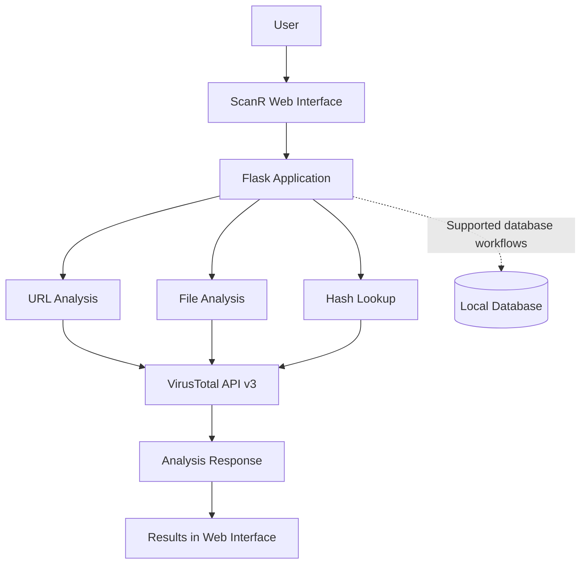

<div align="center">


<p><strong>A Web-Based Threat Intelligence and Security Analysis Platform</strong></p>

<p>
  <a href="https://github.com/TocsiVector/ScanR"></a>
  
  
  
</p>

<p>
  <a href="#overview">Overview</a> •
  <a href="#features">Features</a> •
  <a href="#architecture">Architecture</a> •
  <a href="#installation">Installation</a> •
  <a href="#api-reference">API</a> •
  <a href="#security">Security</a>
</p>

</div>

---

## Overview

**ScanR** is a cybersecurity project that provides a web interface for supported URL, file, and file-hash analysis workflows using Python, Flask, and VirusTotal intelligence.

The project brings scanning components and threat-intelligence lookups into one place to help users investigate suspicious indicators.

> **Project status:** This repository is under active development. Feature availability depends on the current implementation, VirusTotal API permissions, and local configuration. Not every protection component is production-ready.

## Features

| Feature | Description |
|---|---|
| URL analysis | Submit URLs through the supported scanning workflow. |
| File analysis | Analyze supported files through the backend. |
| Hash lookup | Query supported file hashes against threat intelligence. |
| VirusTotal integration | Connect to VirusTotal API v3 using an API key. |
| Web interface | Access scanning functionality through a Flask-served frontend. |
| Scan history | Database components are included for scan-history functionality. |
| Relationship lookups | Includes backend routes for supported VirusTotal relationship queries. |
| Protection modules | Separate protection and feed-related components are present; verify configuration and behavior before relying on them. |

## Technology Stack

<p>
  
  
  
  
  
  
  
</p>

- Python and Flask — backend application
- Requests — HTTP/API communication
- python-dotenv — environment configuration
- VirusTotal API v3 — threat-intelligence lookups
- HTML, CSS, and JavaScript — web interface
- SQLite/database components — local data storage

## Architecture



*This diagram shows the high-level analysis workflow. Exact behavior depends on the route and module being used.*

## Repository Structure

```text
ScanR/
├── app.py
├── requirements.txt
├── .env.example
├── database/
├── scanner/
│   ├── file_scanner.py
│   ├── hash_scanner.py
│   ├── hash_utils.py
│   ├── relations_api.py
│   ├── url_scanner.py
│   └── virustotal.py
├── scanr_protection/
├── static/
│   └── index.html
├── files/
├── tests/
├── reports/
├── .gitignore
├── LICENSE
└── README.md
```

The repository may contain additional scripts and modules. This is a high-level overview, not a complete file inventory.

## Installation

### Prerequisites

- Windows, Linux, or macOS
- Python 3.10 or newer recommended
- Git
- Internet connection for VirusTotal lookups
- A VirusTotal API key

### 1. Clone the repository

```bash
git clone https://github.com/TocsiVector/ScanR.git
cd ScanR
```

### 2. Create and activate a virtual environment

**Windows PowerShell**

```powershell
py -m venv .venv
.\.venv\Scripts\Activate.ps1
```

If PowerShell blocks activation, allow it for the current process only:

```powershell
Set-ExecutionPolicy -Scope Process -ExecutionPolicy Bypass
.\.venv\Scripts\Activate.ps1
```

**Linux/macOS**

```bash
python3 -m venv .venv
source .venv/bin/activate
```

### 3. Install dependencies

```bash
python -m pip install --upgrade pip
pip install -r requirements.txt
```

### 4. Configure your VirusTotal API key

Create a `.env` file in the project root and add your own key:

```dotenv
VT_API_KEY=your_own_virustotal_api_key
```

Replace the placeholder with your actual key.

**Never commit `.env` or publish your API key.** The repository's `.env.example` should contain placeholders only.

### 5. Start ScanR

```bash
python app.py
```

Open the local address printed by Flask. If the application uses the default development configuration, it is commonly:

```text
http://127.0.0.1:5000
```

If startup fails, check the terminal output, Python dependencies, environment configuration, and API permissions.

## API Reference

The project includes the following backend routes. Request methods, required fields, and response formats should be confirmed in the current source code.

| Endpoint | Purpose |
|---|---|
| `GET /` | Serves the web interface. |
| `GET /health` | Health-check route. |
| `GET /api/status` | Scanner/application status. |
| `GET /api/history` | Scan-history endpoint. |
| `GET /api/history/<scan_id>` | Retrieve a scan-history entry. |
| `POST /api/scan/url` | URL-analysis workflow. |
| `POST /api/scan/file` | File-analysis workflow. |
| `POST /api/scan/hash` | Hash-analysis workflow. |
| `GET /api/file/<resource_id>/<relation>` | File relationship lookup. |
| `POST /api/relations` | Relationship lookup through the supported request format. |
| `GET /api/relations/status` | Relationship module status. |

VirusTotal relationship lookups may depend on the permissions and quotas of your API plan. These routes are not a guarantee that every query will succeed.

## Screenshots

Add genuine screenshots of the running application here when available.

| Web Interface | Analysis Results |
|---|---|
| `docs/screenshots/dashboard.png` — add screenshot | `docs/screenshots/results.png` — add screenshot |

| URL Analysis | File Analysis |
|---|---|
| Add a screenshot of a real URL-analysis result. | Add a screenshot of a real file-analysis result. |

*The screenshot paths above are placeholders, not existing images.*

## Testing

Run the available tests from the repository root:

```powershell
python -m pytest
```

Some tests may need additional configuration or a test environment. A passing test suite should not be assumed until the tests have actually been executed.

## Security

- Analyze only files, URLs, and systems you are authorized to investigate.
- Keep your VirusTotal API key private.
- Review the applicable VirusTotal terms and API limits before use.
- A clean or inconclusive result does **not** prove that a file or URL is safe.
- Do not expose the Flask development server directly to the public internet.
- Review protection-related modules before enabling them.
- Do not treat ScanR as a replacement for a complete endpoint protection platform.

## Limitations

- Analysis depends on API availability, quotas, permissions, and vendor detections.
- Some relationship queries may be restricted by the VirusTotal plan.
- Browser-extension and automatic-protection capabilities require separate verification.
- This README does not claim that every module is production-ready.

## Roadmap

Potential future improvements, subject to implementation and testing:

- [ ] Add verified application screenshots.
- [ ] Expand automated tests and error handling.
- [ ] Improve setup and troubleshooting documentation.
- [ ] Validate protection modules and document their supported behavior.
- [ ] Complete and test any planned browser-extension integration.

## Contributing

Contributions and constructive feedback are welcome.

1. Fork the repository.
2. Create a feature branch.
3. Make a focused change.
4. Test the change.
5. Open a pull request describing the implementation and test results.

## License

This project includes a [LICENSE](LICENSE) file. Review it for the applicable terms.

## Repository

<div align="center">

**ScanR — Threat Intelligence & Security Analysis**

[View on GitHub](https://github.com/TocsiVector/ScanR)

<sub>Built as a cybersecurity development project.</sub>

</div>
