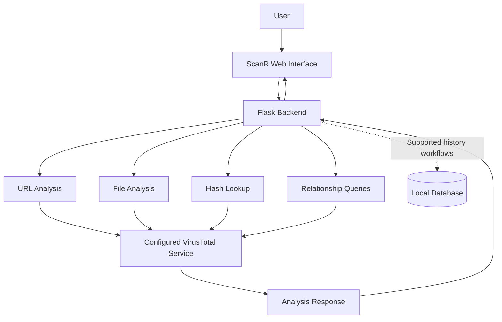

# ScanR — Threat Intelligence & Security Analysis


<div align="center">

**Analyze. Investigate. Understand.**

A Python and Flask-based cybersecurity web application for supported URL, file, hash, and threat-intelligence analysis workflows using VirusTotal API v3.


[Repository](https://github.com/GhostMaskR/ScanR) · [Installation](#installation) · [API Reference](#api-reference) · [Security](#security-and-privacy)

</div>

---

## Table of Contents

1. [Project Overview](#project-overview)
2. [Project Objectives](#project-objectives)
3. [Features](#features)
4. [Technology Stack](#technology-stack)
5. [System Architecture](#system-architecture)
6. [Repository Structure](#repository-structure)
7. [Requirements](#requirements)
8. [Installation](#installation)
9. [Configuration](#configuration)
10. [Running ScanR](#running-scanr)
11. [API Reference](#api-reference)
12. [Testing and Verification](#testing-and-verification)
13. [Security and Privacy](#security-and-privacy)
14. [Troubleshooting](#troubleshooting)
15. [Current Development Status](#current-development-status)
16. [Roadmap](#roadmap)
17. [Contributing](#contributing)
18. [License](#license)

---

## Project Overview

**ScanR** is a cybersecurity development project designed to bring supported scanning and threat-intelligence workflows into a single web application.

Built with Python and Flask, ScanR provides a web interface connected to backend scanning modules, VirusTotal API v3 integration, and database-backed application workflows.

The project aims to make initial security investigation easier by allowing users to work with URLs, files, hashes, and supported threat-intelligence relationships through a unified interface.

ScanR is intended as a learning, development, and security-analysis project. Its capabilities depend on the implemented modules, configuration, external service availability, API permissions, and testing.

> **Development notice:** ScanR is under active development. Core unit tests and the Phase 2 smoke test have passed in the current development environment. End-to-end VirusTotal scanning through the central gateway still requires verification.

## Project Objectives

The main objectives of ScanR are:

- Provide a unified interface for supported security-analysis workflows.
- Integrate VirusTotal threat-intelligence lookups into backend scanning components.
- Support URL, file, and file-hash analysis workflows.
- Provide supported relationship queries for further investigation.
- Maintain local scan-history workflows through database components.
- Return useful application status and error information.
- Keep API credentials separate from frontend code and public source files.
- Build a foundation for future cybersecurity analysis features.

## Features

### 1. URL Analysis

ScanR includes a URL-analysis workflow intended to investigate supported URLs through the application's scanning implementation and configured threat-intelligence service.

The available results depend on the implementation, the URL submitted, and the upstream service response.

### 2. File Analysis

The project includes backend file-analysis components for supported file inputs.

File scanning must be tested with permitted, harmless test files. File size limits, validation rules, and upstream API requirements may affect availability.

### 3. Hash Lookup

ScanR supports file-hash analysis workflows.

Hash lookups can help investigate files without uploading the original file when a matching report is available from VirusTotal.

A missing report does not mean that a file is safe.

### 4. Threat Intelligence

ScanR integrates with VirusTotal API v3 for supported analysis and relationship queries.

Results depend on VirusTotal's available intelligence, API permissions, account plan, rate limits, and service availability.

### 5. Relationship Queries

The application includes relationship endpoints for supported file and URL investigations.

Relationship availability depends on the selected relationship, the upstream API, and the permissions associated with the configured VirusTotal account.

### 6. Scan History

Database components support local scan-history workflows.

History availability depends on successful database initialization and the relevant application routes.

### 7. Application Status

ScanR provides health and status endpoints to help inspect application availability and configuration state.

### 8. Central Gateway Integration

The project includes configuration for using a central ScanR gateway for supported VirusTotal requests.

In central mode, the gateway is expected to hold the VirusTotal credential on the server side. The application must be configured with a real, reachable gateway URL before this mode can be used.

The deployed gateway's actual URL/file scanning behavior still requires end-to-end verification.

---

## Technology Stack

| Technology | Purpose |
|---|---|
| Python | Backend application and scanning logic |
| Flask | Web application and API routes |
| HTML | Web interface structure |
| CSS | Interface styling |
| JavaScript | Frontend interactions |
| SQLite/database components | Local application data and scan history |
| Requests | HTTP communication |
| python-dotenv | Local environment configuration |
| VirusTotal API v3 | Threat-intelligence lookups |
| Git | Version control |
| GitHub | Source-code hosting and collaboration |

---

## System Architecture



### Workflow Explanation

1. The user interacts with the ScanR web interface.
2. The frontend sends a request to a supported Flask endpoint.
3. The backend validates the input and selects the relevant analysis component.
4. The component communicates with the configured VirusTotal service when required.
5. The backend processes the available response and returns the result.
6. Supported database workflows handle local application records and scan history.

The exact request fields, validation behavior, response formats, and error handling are determined by the current implementation.

---

## Repository Structure

The following is a simplified overview of the project:

```text
ScanR/
├── app.py
├── requirements.txt
├── .env.example
├── database/
├── scanner/
│   ├── file_scanner.py
│   ├── hash_scanner.py
│   ├── hash_utils.py
│   ├── relations_api.py
│   ├── url_scanner.py
│   └── virustotal.py
├── static/
│   └── index.html
├── files/
├── tests/
├── reports/
├── LICENSE
└── README.md
```

This structure is illustrative and not an exhaustive file listing. Additional scripts, modules, and directories may exist in the repository.

---

## Requirements

Before installing ScanR, make sure you have:

- Python 3.10 or newer recommended.
- Git installed.
- Internet access for online threat-intelligence requests.
- A compatible Python environment.
- Either an authorized, configured ScanR central gateway or your own VirusTotal API key.
- Access to the dependencies listed in `requirements.txt`.

Some features may require additional configuration or API permissions.

---

## Installation

### Step 1 — Clone the Repository

Open a terminal and run:

```bash
git clone https://github.com/GhostMaskR/ScanR.git
cd ScanR
```

### Step 2 — Create a Virtual Environment

**Windows PowerShell**

```powershell
py -m venv .venv
.\.venv\Scripts\Activate.ps1
```

If PowerShell blocks activation, allow it for the current process only:

```powershell
Set-ExecutionPolicy -Scope Process -ExecutionPolicy RemoteSigned
.\.venv\Scripts\Activate.ps1
```

**Linux or macOS**

```bash
python3 -m venv .venv
source .venv/bin/activate
```

Using a virtual environment helps keep project dependencies separate from other Python installations.

### Step 3 — Install Dependencies

With the virtual environment activated, run:

```bash
python -m pip install --upgrade pip
pip install -r requirements.txt
```

Wait for installation to finish and review any errors before proceeding.

---

## Configuration

ScanR supports two intended configuration approaches in the current code: a central gateway URL or a local VirusTotal API key.

### Option A — Central Gateway

Configure the `SCANR_CENTRAL_API_URL` environment variable in your local `.env` file.

Use the actual HTTPS URL of a deployed ScanR gateway that you are authorized to access.

**Important:** The example URL in `.env.example` is a placeholder, not a working service. Cloning the repository does not automatically grant access to a shared gateway.

A usable central gateway must:

- Be deployed and reachable.
- Have its VirusTotal credential configured securely on the server.
- Support the routes expected by the ScanR client.
- Enforce appropriate rate limits and access controls.
- Return compatible responses and errors.

### Option B — Direct VirusTotal API

Alternatively, configure your own VirusTotal API key in the local `.env` file using a secure text editor.

Use a valid key associated with your own account and follow VirusTotal's current API terms and permissions.

Do not place the key in frontend code, source files, screenshots, issues, documentation, or terminal commands.

### Configuration Safety

- Keep `.env` local and untracked.
- Keep `.env.example` limited to placeholder values.
- Do not publish API credentials.
- Do not assume a gateway is operational merely because its URL is configured.
- If a credential has been exposed, revoke or rotate it through the provider's official account controls.

---

## Running ScanR

After completing installation and configuration, start the Flask application from the project root:

```powershell
python app.py
```

If the application starts successfully, open the local address shown in the terminal.

The default Flask development address is commonly:

`http://127.0.0.1:5000`

The actual address depends on the application's configuration.

### Local Development Warning

The Flask development server is intended for local development. Do not expose it directly to the public internet.

A public deployment requires production-grade hosting, access controls, rate limiting, logging, secure configuration, and a security review.

---

## API Reference

The following routes are present in the current application structure. The route handlers remain the authoritative source for exact request formats, validation rules, and response fields.

| Method | Endpoint | Purpose |
|---|---|---|
| `GET` | `/` | Serve the web interface |
| `GET` | `/health` | Check application health |
| `GET` | `/api/status` | Inspect application and scanner configuration |
| `GET` | `/api/history` | Retrieve scan history |
| `GET` | `/api/history/<scan_id>` | Retrieve an individual history entry |
| `POST` | `/api/scan/url` | URL-analysis workflow |
| `POST` | `/api/scan/file` | File-analysis workflow |
| `POST` | `/api/scan/hash` | Hash-analysis workflow |
| `GET` | `/api/file/<resource_id>/<relation>` | Query a file relationship |
| `POST` | `/api/relations` | Submit a relationship query |
| `GET` | `/api/relations/status` | Inspect relationship-module status |

### Local Health Check

Once the application is running, check its health from PowerShell:

```powershell
Invoke-RestMethod -Uri "http://127.0.0.1:5000/health"
```

### Application Status

```powershell
Invoke-RestMethod -Uri "http://127.0.0.1:5000/api/status"
```

### Scan History

```powershell
Invoke-RestMethod -Uri "http://127.0.0.1:5000/api/history"
```

### API Notes

- Request schemas can change as the project develops.
- Check the relevant route handler before building external integrations.
- A successful HTTP response does not necessarily mean that a threat-intelligence report was found.
- VirusTotal may return an error if a resource is unavailable, an API limit is reached, or the configured account lacks permission.
- Do not interpret missing or zero-detection results as proof that an item is safe.

---

## Testing and Verification

Run the built-in tests from the repository root with the virtual environment activated.

### Core Unit Tests

```powershell
python -m unittest discover -s tests -p "test_*.py" -v
```

### Phase 2 Smoke Test

```powershell
python -m tests.phase2_smoke_test
```

### Python Syntax Validation

```powershell
python -m py_compile app.py scanner/virustotal.py scanner/relations_api.py
```

### Reported Development Results

The following results were observed in the current development environment:

| Check | Result |
|---|---|
| Core unit tests | 10 tests passed |
| Phase 2 smoke test | Printed `CORE_TESTS_OK` |
| Python syntax validation | Passed |
| Git staged-diff validation | Passed before the integration commit |
| GitHub integration commit | Created and pushed successfully |

These results describe the tests actually run in that development environment. They do not guarantee that every feature will work on every new installation.

### Manual Verification Checklist

- [ ] The virtual environment activates successfully.
- [ ] Dependencies install without errors.
- [ ] Configuration is valid.
- [ ] The Flask application starts.
- [ ] The health endpoint responds.
- [ ] The homepage loads.
- [ ] URL analysis handles valid and invalid inputs.
- [ ] File analysis handles permitted test files and reports errors clearly.
- [ ] Hash lookup handles valid hashes and missing reports.
- [ ] Scan history works with empty and populated history.
- [ ] Relationship routes handle unsupported relationships and upstream errors.
- [ ] A real, harmless URL is successfully processed through the intended VirusTotal configuration.
- [ ] Gateway timeouts, API limits, and invalid configuration are handled safely.

Only mark a checklist item complete after testing it.

---

## Security and Privacy

### 1. Protect API Credentials

Never commit `.env`, API keys, tokens, or other private credentials.

Keep configuration examples free of real secrets. Rotate credentials if they are exposed.

### 2. Protect the Central Gateway

A shared gateway must keep its VirusTotal key server-side.

A gateway that is publicly reachable should use appropriate access controls, rate limits, monitoring, and abuse protection. Do not expose an unrestricted personal API key through a public endpoint.

### 3. Respect Privacy

Sending a URL, file, or identifier to VirusTotal can share information with an external service.

Do not submit confidential or sensitive material unless you have authorization and have considered the applicable privacy requirements.

### 4. Use Authorized Test Inputs

Analyze only files, URLs, and systems you are permitted to investigate.

Use harmless test inputs when verifying the application.

### 5. Interpret Results Carefully

VirusTotal results are threat-intelligence signals, not a guarantee of safety.

Zero detections, a missing report, or an unknown classification does not prove that a resource is harmless.

### 6. Respect API Limits

Availability depends on the provider's current API terms, account permissions, quotas, and endpoint restrictions.

### 7. Understand Project Limitations

ScanR is a cybersecurity development project. It should not be treated as a complete antivirus, endpoint detection and response (EDR), or enterprise security platform.

Protection, feed, and extension-related components should be verified independently before being relied on.

---

## Troubleshooting

### ScanR Does Not Start

1. Activate the virtual environment.
2. Install the dependencies listed in `requirements.txt`.
3. Run the application from the repository root.
4. Review the complete terminal error.
5. Confirm the installed Python version is compatible with the project.

### Configuration Is Not Detected

1. Confirm the local `.env` file is in the project root.
2. Check the spelling of the expected environment variable.
3. Confirm the configured gateway uses HTTPS.
4. Verify that the gateway is actually deployed and reachable.
5. Never share credentials in screenshots, issues, or logs.

### A URL or Hash Has No Report

VirusTotal may not have a report for every resource. Verify the input format and inspect the response returned by ScanR.

A missing report does not mean that the resource is safe.

### A Relationship Request Returns 403

The requested relationship may not be available to the configured VirusTotal account or plan. Check the provider's current API permissions and terms.

### A Request Times Out

A timeout may result from connectivity problems, an unavailable upstream service, or gateway configuration. Check the application logs and gateway health without exposing credentials.

### A Fresh Clone Behaves Differently

A fresh installation has its own environment, dependencies, database state, and configuration. Follow the installation steps and run the tests in that environment. A Git clone alone does not supply private API credentials or grant access to a shared gateway.

---

## Current Development Status

ScanR's latest integration changes were committed and pushed to the `scanr-final-update-20261018_095835` branch.

The integration commit is:

`89c32bf — Integrate ScanR central VirusTotal gateway`

The current verified development results include successful core tests, the Phase 2 smoke test, Python syntax checks, and the GitHub push.

**Still pending:** Successful end-to-end URL and file scanning through the central gateway has not yet been independently confirmed. A clean Git push does not by itself prove that the deployed scanning workflow works.

The database, local backups, and unrelated untracked files were not included in that integration commit.

---

## Roadmap

- [ ] Verify central-gateway URL scanning end to end.
- [ ] Verify central-gateway file scanning end to end.
- [ ] Verify hash and relationship workflows through the intended configuration.
- [ ] Expand automated tests for gateway errors, timeouts, and API limits.
- [ ] Improve setup and troubleshooting documentation.
- [ ] Add genuine screenshots from a running ScanR instance.
- [ ] Verify protection and feed-related components separately.
- [ ] Review deployment security before public hosting.
- [ ] Continue improving error handling and user-facing status messages.

---

## Contributing

Contributions, bug reports, and focused improvements are welcome.

1. Fork the [ScanR repository](https://github.com/GhostMaskR/ScanR).
2. Create a branch for a focused change.
3. Keep API keys, `.env`, local databases, scan artifacts, and private reports out of commits.
4. Run relevant tests and manually verify the affected workflow.
5. Update documentation when configuration, endpoints, or behavior changes.
6. Open a pull request describing the problem, implementation, and actual test results.

Please do not describe a feature as complete unless its implementation and expected behavior have been verified.

---

## License

See the repository's [LICENSE](LICENSE) file for the applicable terms.

---

<div align="center">


**ScanR — Analyze. Investigate. Understand.**

[GitHub Repository](https://github.com/GhostMaskR/ScanR)

*Cybersecurity development project · Built with Python and Flask*

</div>
