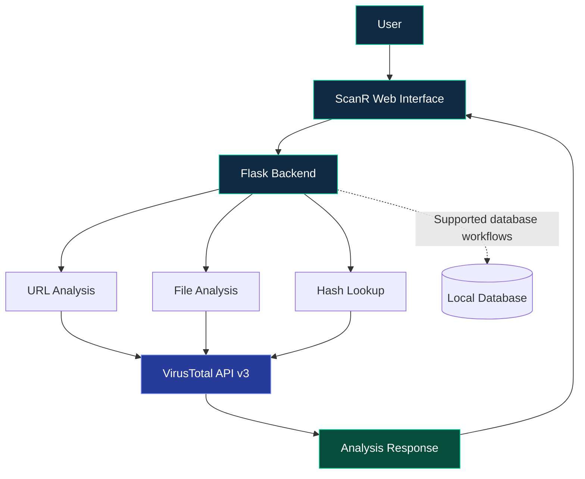

<div align="center">


<br/>


<br/><br/>

**A web-based platform for URL, file and hash analysis using VirusTotal intelligence.**

[Explore Repository](https://github.com/TocsiVector/ScanR) · [Installation](#-installation) · [API Reference](#-api-reference) · [Security](#-security)

</div>

---

<div align="center">


</div>

## `01` — Overview

**ScanR** is a cybersecurity development project built with Python and Flask. It brings supported URL, file and hash analysis workflows together with VirusTotal threat-intelligence lookups.

The aim is to make security investigation easier through a web interface, backend scanning modules and supporting database components.

> **Development notice:** ScanR is still under development. Each module must be configured and tested independently. Features listed here describe repository components and are not a guarantee of production readiness.

## `02` — Feature Matrix

<table>
<tr>
<td width="50%" valign="top">

### 

Submit URLs through the supported analysis workflow to investigate available threat-intelligence results.

</td>
<td width="50%" valign="top">

### 

Use the file-analysis components to inspect supported files through the backend.

</td>
</tr>
<tr>
<td width="50%" valign="top">

### 

Query supported file hashes against available VirusTotal intelligence.

</td>
<td width="50%" valign="top">

### 

Use VirusTotal API v3 for supported analysis and relationship lookups.

</td>
</tr>
<tr>
<td width="50%" valign="top">

### 

Access the supported scanning workflows through the Flask-served web interface.

</td>
<td width="50%" valign="top">

### 

The repository includes database components for local application data and scan-history workflows.

</td>
</tr>
</table>

### Protection components

The repository also includes protection and feed-related modules. Browser protection, automatic monitoring and other protection features should be treated as **separate components requiring verification** before use.

## `03` — Technology Stack

<div align="center">


<br/><br/>


</div>

## `04` — System Architecture



<details>
<summary><strong>How the workflow operates</strong></summary>

1. The user interacts with the web interface.
2. Flask routes the request to the appropriate analysis component.
3. The relevant scanner communicates with VirusTotal when required.
4. The backend processes the response and returns available results.
5. Supported database routes handle local application data.

Exact request formats, error handling and API permissions depend on the implementation.

</details>

## `05` — Repository Structure

```text
ScanR/
├── app.py
├── requirements.txt
├── .env.example
├── database/
├── scanner/
│   ├── file_scanner.py
│   ├── hash_scanner.py
│   ├── hash_utils.py
│   ├── relations_api.py
│   ├── url_scanner.py
│   └── virustotal.py
├── scanr_protection/
├── static/
│   └── index.html
├── files/
├── tests/
├── reports/
├── LICENSE
└── README.md
```

This is a simplified overview. Additional scripts and modules may exist in the repository.

## `06` — Installation

### Requirements

- Python 3.10 or newer recommended
- Git
- Internet connection for VirusTotal lookups
- Your own VirusTotal API key

### Step 1 — Clone

```bash
git clone https://github.com/TocsiVector/ScanR.git
cd ScanR
```

### Step 2 — Create a virtual environment

**Windows PowerShell**

```powershell
py -m venv .venv
.\.venv\Scripts\Activate.ps1
```

If activation is blocked, allow it only for the current PowerShell process:

```powershell
Set-ExecutionPolicy -Scope Process -ExecutionPolicy Bypass
.\.venv\Scripts\Activate.ps1
```

**Linux / macOS**

```bash
python3 -m venv .venv
source .venv/bin/activate
```

### Step 3 — Install dependencies

```bash
python -m pip install --upgrade pip
pip install -r requirements.txt
```

### Step 4 — Configure your API key

Create a local `.env` file in the project root:

```dotenv
VT_API_KEY=your_own_virustotal_api_key
```

Replace the placeholder with your own VirusTotal API key.

**Never publish your real `.env` file or API key.** Keep `.env.example` limited to placeholder values.

### Step 5 — Run ScanR

```powershell
python app.py
```

Open the local URL shown in the terminal. If Flask uses its default local development address, it is commonly:

`http://127.0.0.1:5000`

If startup fails, check dependencies, environment variables, terminal errors and API permissions.

## `07` — API Reference

The repository contains the following routes. Confirm the required methods, parameters and response schemas in the current source code before integrating them.

| Endpoint | Purpose |
|---|---|
| `GET /` | Web interface |
| `GET /health` | Health check |
| `GET /api/status` | Application/scanner status |
| `GET /api/history` | Scan history |
| `GET /api/history/<scan_id>` | Individual history entry |
| `POST /api/scan/url` | URL-analysis workflow |
| `POST /api/scan/file` | File-analysis workflow |
| `POST /api/scan/hash` | Hash-analysis workflow |
| `GET /api/file/<resource_id>/<relation>` | File relationship lookup |
| `POST /api/relations` | Relationship query |
| `GET /api/relations/status` | Relationship module status |

Some relationship queries may be restricted by the VirusTotal account or API plan.

## `08` — Screenshots & Demo

<div align="center">

| Dashboard | Analysis Results |
|---|---|
| Add `docs/screenshots/dashboard.png` | Add `docs/screenshots/results.png` |

</div>

> These are screenshot placeholders, not existing images. Replace them with genuine screenshots from a running ScanR instance.

## `09` — Testing

Run available tests from the repository root:

```powershell
python -m pytest
```

Some tests may require extra configuration. Do not assume the test suite passes until it has been executed successfully.

## `10` — Security

- Only analyze files, URLs and systems you are authorized to inspect.
- Keep your VirusTotal API key private.
- Respect VirusTotal terms, permissions and API quotas.
- A clean or inconclusive result does not guarantee that a file or URL is safe.
- Do not expose Flask's development server directly to the public internet.
- Review protection modules before enabling them.
- ScanR is not a replacement for a complete endpoint protection platform.

## `11` — Roadmap

- [ ] Add real application screenshots.
- [ ] Expand automated tests and error handling.
- [ ] Improve setup and troubleshooting documentation.
- [ ] Verify protection modules and document their exact capabilities.
- [ ] Complete and test planned browser-extension integration.

## `12` — Contributing

1. Fork the repository.
2. Create a feature branch.
3. Make a focused change.
4. Test your changes.
5. Submit a pull request with implementation details and test results.

## License

See the repository's [LICENSE](LICENSE) file for the applicable terms.

---

<div align="center">


**ScanR — Analyze. Investigate. Understand.**

[GitHub Repository](https://github.com/TocsiVector/ScanR)

<sub>Cybersecurity development project · Built with Python and Flask</sub>

</div>
